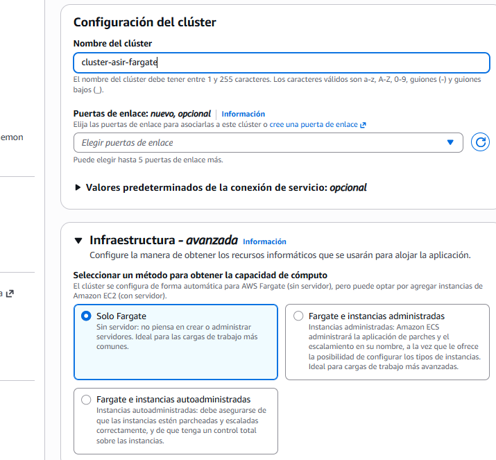
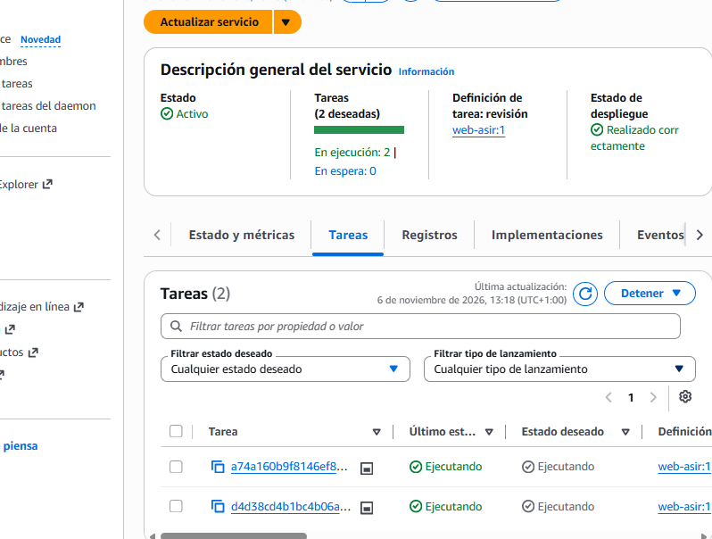

## Práctica 304 de Julián ALmarza Álvarez
1. Guía paso a paso
Paso 1: Creación del clúster ECS con AWS Fargate
En la consola de AWS, buscar y acceder a ECS (Elastic Container Service).
En el panel izquierdo, hacer clic en Clusters y pulsar en Create cluster.
Rellenar los parámetros de configuración:
Cluster name: cluster-asir-fargate
Infrastructure: Marcar la casilla AWS Fargate (serverless).
Dejar el resto de opciones por defecto (VPC y subredes por defecto del laboratorio).
Pulsar en Create. El proceso tardará unos segundos.

2. Paso 2: Creación de la Definición de Tarea (Task Definition)
En el menú lateral izquierdo de ECS, ir a Task definitions y pulsar en Create new task definition.
Configuration:
Task definition family: task-web-asir.
Launch type: Seleccionar AWS Fargate.
Operating system/architecture: Linux/X86_64.
Network mode: awsvpc (obligatorio para Fargate).
Task size (Recursos de cómputo):
Task CPU: 0.25 vCPU (256 unidades).
Task memory: 0.5 GB (512 MB).
Container - 1:
Name: web-nginx.
Image uri: Utilizar una imagen pública estándar de Docker Hub, por ejemplo: nginx:alpine o una imagen web personalizada alojada en Amazon ECR.
Port mappings:
Container port: 80.
Protocol: tcp.
App protocol: HTTP.
Environment / Roles (Restricción de AWS Academy):
Localizar la sección Task execution role y asegurarse de seleccionar el rol existente denominado LabRole (esto permite a ECS descargar imágenes y escribir logs en CloudWatch sin crear nuevos roles IAM).
Pulsar en Create en la esquina inferior derecha.

