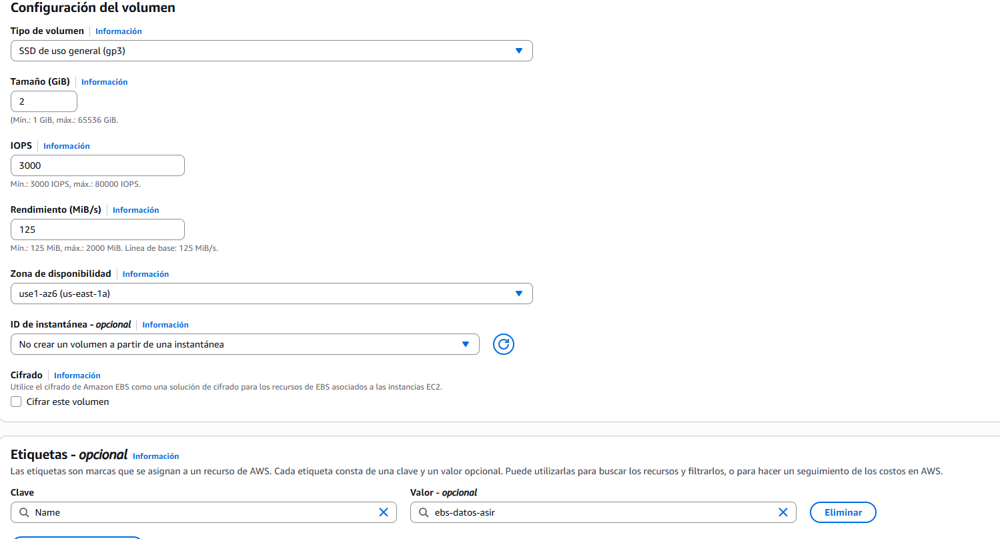
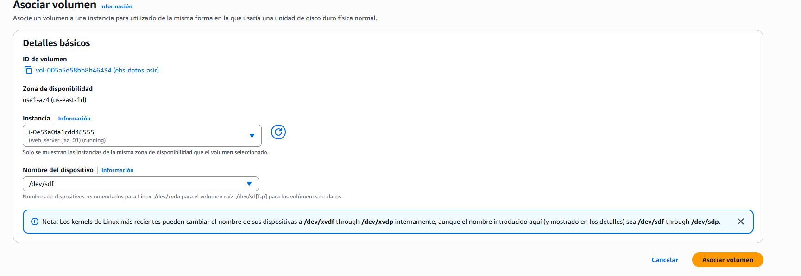
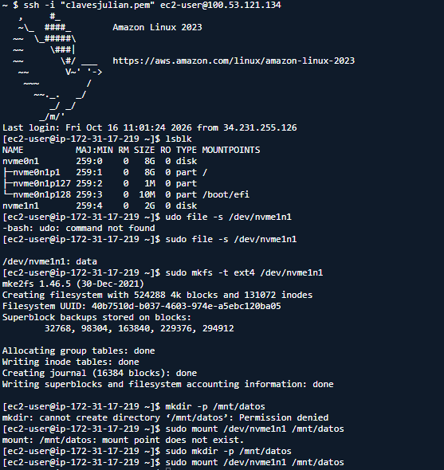
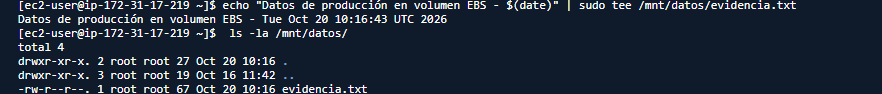
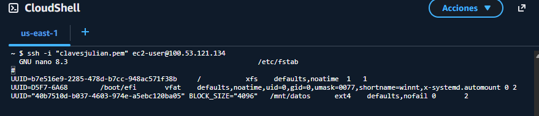

## Práctica 202 de Julián ALmarza Álvarez

1. paso 1: Verificación de la zona y lanzamiento de la máquina base
En la consola de AWS, acceder a EC2 > Instances.
Lanzar una instancia base con Amazon Linux 2023, tipo t2.micro o t3.micro, asociada al Security Group de servidor web (sg-servidor-web-asir) y con par de claves.
No te olvides de seleccionar la instancia en el panel y localizar en los detalles el campo Availability Zone (por ejemplo, us-east-1a). Anota este valor exacto.

2. Paso 2: Creación y conexión del volumen EBS

En el menú lateral izquierdo, navegar a Elastic Block Store > Volumes.
Pulsar en Create volume y configurar los parámetros:
Volume type: General Purpose SSD (gp3).
Size (GiB): 2 (suficiente para la prueba y ahorra cuota de laboratorio).
Availability Zone: seleccionar exactamente la misma zona que la instancia del Paso 1.
Tags: Clave Name, Valor ebs-datos-asir.





Hacer clic en Create volume. Esperar unos segundos a que el estado del volumen cambie de Creating a Available.
Seleccionar el volumen recién creado, pulsar en el menú Actions > Attach volume.
En el campo Instance, seleccionar la máquina virtual base.
En Device name, la consola propondrá una ruta estándar como /dev/sdf. Aceptar el valor por defecto y confirmar pulsando en Attach volume. El estado del volumen pasará a In-use.





3. Paso 3: Configuración del almacenamiento en el sistema operativo

Conectarse a la instancia mediante SSH con el usuario ec2-user.
Inspeccionar la topología de bloques detectada por el núcleo de Linux con lsblk. Deberías observar aquí el disco raíz (nvme0n1) con sus particiones y un nuevo disco sin particionar de 2 GB denominado generalmente nvme1n1.
Verificar si el nuevo disco contiene ya algún sistema de archivos con 
```
sudo file -s /dev/nvme1n1.
```

Si la respuesta es: /dev/nvme1n1: data, el disco está completamente vacío y requiere formateo.
Formatear el dispositivo completo directamente con el sistema de archivos ext4 con la orden ``` sudo mkfs -t ext4 /dev/nvme1n1 ```
Crear el directorio que servirá como punto de montaje (mkdir -p /mnt/datos) y asociar el disco ``` sudo mount /dev/nvme1n1 /mnt/datos ```





Crear un archivo de prueba para comprobar la persistencia de datos:


```
echo "Datos de producción en volumen EBS - $(date)" | sudo tee /mnt/datos/evidencia.txt
 ls -la /mnt/datos/
```





4. Paso 4: Automatización del montaje en ```/etc/fstab mediante UUID```
Obtener el UUID asignado a la partición o disco formateado: sudo blkid /dev/nvme1n1. Copiar el identificador alfanumérico que aparece en el atributo UUID="..." (por ejemplo, e2a7b8c1-3f4a-4b9a-8e2b-1a2b3c4d5e6f).
Crear una copia de respaldo del archivo de configuración antes de editarlo: sudo cp /etc/fstab /etc/fstab.bak
Abrir /etc/fstab con un editor de texto y añadir al final del archivo una línea con la siguiente sintaxis (reemplazando el UUID por el obtenido):
```
 UUID=tu-uuid-aqui    /mnt/datos    ext4    defaults,nofail    0    2
```





Para comprobar que la sintaxis de /etc/fstab es correcta antes de reiniciar, desmontar el disco y forzar la recarga de todos los puntos de montaje declarados realiza la siguiente comprobación. Si el comando``` mount -a``` no devuelve ningún error y al ejecutar ``` df -h /mnt/datos``` el disco vuelve a aparecer montado, la configuración es correcta y segura frente a reinicios.

```
sudo umount /mnt/datos
 sudo mount -a
```